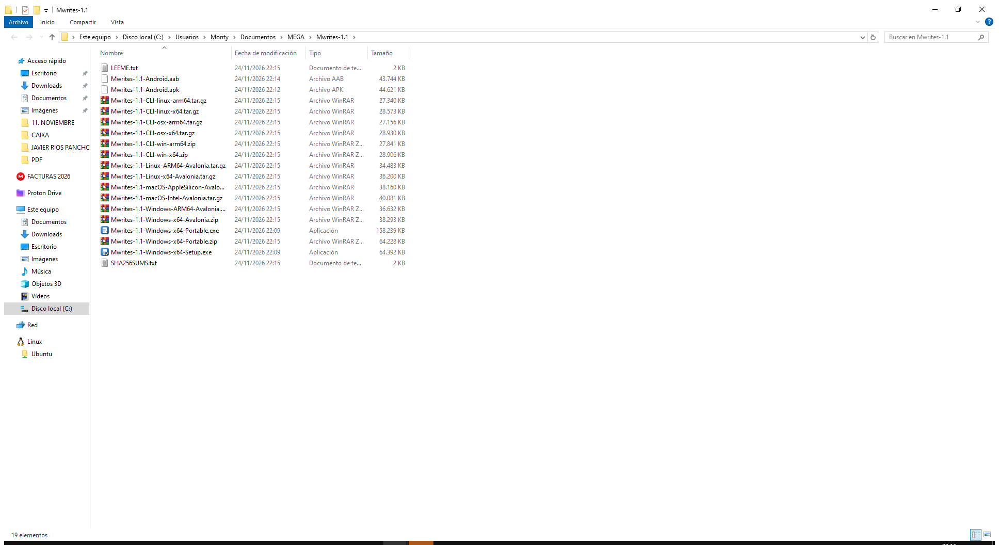
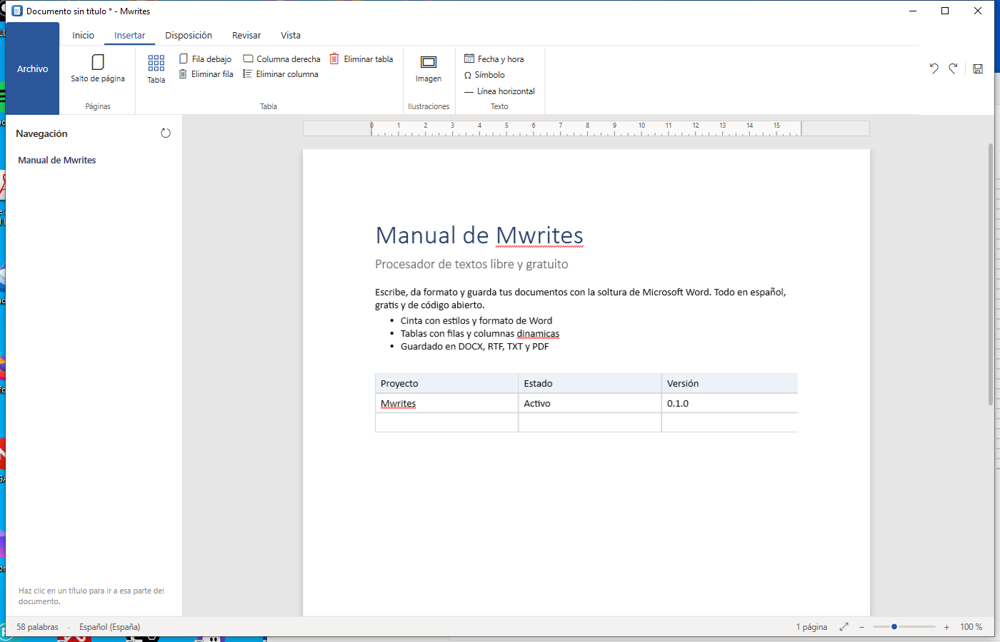

# Mwrites

Procesador de textos con la apariencia de Microsoft Word y un flujo de trabajo pensado para escribir sin distracciones. Es gratuito, open source y funciona sin conexión: todos los documentos se guardan en tu equipo.

La edición completa para Windows es WPF. Las ediciones portable (Avalonia) funcionan en Windows, Linux, macOS, Android e iOS con un subconjunto de funciones.



## Funciones

### Documentos
- Abrir y guardar en **.docx**, **.rtf** y **.txt**, conservando títulos, listas, tablas, imágenes y saltos de página (edición WPF).
- Documento nuevo con estilos listos para usar, lista de archivos recientes e impresión.
- Aviso de cambios sin guardar al cerrar o abrir otro documento.
- Formato nativo **.mwdoc** (JSON) en la edición portable.

### Edición de texto
- Fuente, tamaño, negrita, cursiva, subrayado, tachado, subíndice y superíndice.
- Color de letra y resaltado.
- Alineación, sangría, viñetas, listas numeradas e interlineado.
- Deshacer y rehacer, cortar, copiar, pegar y seleccionar todo.
- Buscar y reemplazar, con reemplazo de todas las apariciones.
- **Cambiar mayúsculas y minúsculas** desde Inicio → Edición (botón **Aa**): MAYÚSCULAS, minúsculas, Iniciales De Cada Palabra y Estilo frase. Se aplica a la selección o a todo el documento.

### Estilos
- Normal, Título 1, Título 2, Título 3, Subtítulo y Cita.
- El panel de navegación muestra los títulos del documento para saltar entre secciones.
- Al pulsar Intro al final de un título, el párrafo siguiente vuelve al estilo Normal.

### Tablas
- Insertar tablas de hasta 30 filas y 12 columnas, con encabezado sombreado.
- Barra contextual con **Fila debajo**, **Eliminar fila**, **Columna derecha**, **Eliminar columna** y **Eliminar tabla**.
- Tab recorre las celdas y, en la última, añade una fila nueva; Mayús+Tab vuelve a la anterior.
- Las columnas se reparten el ancho de la página para no salirse de los márgenes.



### Páginas
- Tamaños A4, Carta, Oficio y Ejecutivo, orientación vertical u horizontal y márgenes configurables.
- Salto de página visible con una marca discontinua y una etiqueta, como en Word.
- Contador de palabras y de páginas, regla y líneas de cuadrícula.

### Vistas
- Modo lectura y modo sin distracciones (Esc para salir).
- Zoom al 100 % o ajustado al ancho de la página.
- Corrector ortográfico en español (España y México), inglés y francés, con sugerencias al hacer clic derecho.

## Edición portable

Disponible para Windows x64/ARM64, Linux x64/ARM64, macOS Intel/Apple Silicon, Android e iOS.

- Abre y guarda **DOCX**, **TXT** y **MWDOC**, y permite crear documentos nuevos.
- Incluye cambio de caso, estadísticas y estilos mediante marcas sencillas: `#`, `##`, `###`, `>` y `-`.
- CLI (`mwrites`) con `sample`, `info`, `stats`, `convert`, `case`, `find` y `replace`. Ejecuta `mwrites help`.
- No incluye tablas, imágenes, corrector ortográfico, impresión, regla, panel de navegación ni formato enriquecido por selección.
- El APK/AAB está firmado con certificado de depuración: hay que firmarlo con la clave de MSoft antes de publicarlo.
- El IPA requiere macOS/Xcode, certificado de distribución y perfil de aprovisionamiento de Apple.

## Descargar

Versión 1.1, con hashes publicados en `SHA256SUMS.txt` de la carpeta de distribución:

- **Mwrites-1.1-Windows-x64-Setup.exe**: instalador para Windows 10/11 de 64 bits. Crea accesos directos, entrada en Aplicaciones instaladas y un desinstalador.
- **Mwrites-1.1-Windows-x64-Portable.exe**: edición WPF portable, sin instalación. No necesita .NET: es un único ejecutable autocontenido.
- **Mwrites-1.1-<plataforma>-Avalonia.***: edición portable para escritorio.
- **Mwrites-1.1-CLI-<plataforma>.***: línea de comandos.
- **Mwrites-1.1-Android.apk / .aab**: edición móvil.

## Compilar

Requisitos: Windows, SDK de .NET 8 y SDK de .NET 11 con workloads `android`, `ios`, `maccatalyst` y `maui-windows`.

```powershell
# Pruebas (núcleo WPF y núcleo portable)
dotnet run --project tests/Mwrites.CoreTests -c Release
dotnet run --project tests/Mwrites.Portable.Tests -c Release

# Todos los artefactos en publish\ y dist\
.\build-all.ps1

# Paquetes para MEGA con SHA256SUMS.txt en C:\Users\Monty\Documents\MEGA\Mwrites-1.1
.\package-mega.ps1
```

Solo Windows WPF:

```powershell
dotnet publish App/Mwrites.App.csproj -c Release -r win-x64 --self-contained true `
    -p:PublishSingleFile=true -p:IncludeNativeLibrariesForSelfExtract=true -o publish
.\build-setup.ps1
```

## Estructura

- `App/`: interfaz WPF, cinta de opciones, panel de navegación y diálogos.
- `Core/`: modelo del documento, lectura y escritura de .docx, estilos, búsqueda y estadísticas.
- `Mwrites.Portable.Core/`: modelo portable sin WPF, lectura/escritura de DOCX/TXT/MWDOC.
- `Mwrites.Portable.App/`: interfaz Avalonia compartida por escritorio y móvil.
- `Mwrites.Desktop/`, `Mwrites.Android/`, `Mwrites.iOS/`: heads de las ediciones portable.
- `Mwrites.Cli/`: herramienta de línea de comandos.
- `tests/`: pruebas de ambos núcleos.
- `Installer/`: instalador y desinstalador de Windows.

## Licencia

MIT. Consulta [LICENSE](LICENSE).
